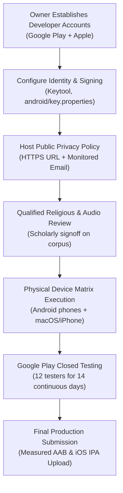

# External Owner Handoff & Release Prerequisites Guide — Zad Alruh (زادُ الروح)

> **Document Status:** External Prerequisite Blueprint — Store Account & Publication Handoff.
> *Last verified on 2026-10-07.*
> **Strict Reality Check:** The project repository contains no developer accounts, no release signing keystores, no public privacy hosting, and no fabricated credentials. All actions in this document must be executed exclusively by the project owner.

---

## 1. Current State & Factual Limitations

To ensure absolute transparency and prevent premature claims of readiness:

1. **Developer Accounts:**
   The owner currently holds **NO active Google Play Developer account** and **NO Apple Developer Program account**.
2. **Release Identity & Signing:**
   No final production application ID has been established; development builds use the local placeholder `dev.zadalruh.zad_alruh`. No upload keystore (`upload-keystore.jks`) or `key.properties` exists in the repository.
3. **Public Endpoints & Contacts:**
   No public HTTPS privacy policy URL is hosted. No official support email is configured. Placeholders in drafts are strictly non-default blank markers requiring owner input. No default domain is assigned.
4. **Hardware & Platform Testing:**
   Development is conducted on a Windows workstation with no connected ADB devices. No macOS system or physical iPhone is available; iOS IPA builds cannot be generated or signed in this environment. An older debug APK from September 29, 2026 (approx. 249 MB uncompressed debug artifact) was transferred to a Samsung Galaxy A54 via MTP, but installation, execution, and audio testing have not been verified.
5. **App Bundle Download Size Status:**
   **The final compressed device-download size is unmeasured and pending.** The 249 MB size of the old debug APK is not a measurement of a release App Bundle, nor is there any empirical measurement proving the release AAB download size is below 200 MB. Final measurement must occur after the release AAB is compiled and analyzed via Google Play Console or bundletool.
6. **Feature Queue Status:**
   - Full-surah MP3Quran streaming (Mishary Alafasy, surahs 001..114) remains **actively queued in the Codex implementation lane** (not yet implemented).
   - Global city picker for all 34,149 GeoNames cities remains **actively queued**; the current UI is limited to 8 legacy settings cities.
   - Scheduled background prayer notifications remain actively queued.
7. **Religious & Audio Validation:**
   No physical speaker audio test has been conducted. Comprehensive human scholarly signoff on the 604-page Quran corpus, Tanzil text alignment, 3,213 Sahih hadiths, 267 Hisn al-Muslim items, and 3 adhan recordings remains pending. **No official religious certification or human signoff may be claimed or fabricated.**

---

## 2. Store Policy Baseline (Rechecked 2026-10-07)

The owner must verify compliance against the latest official platform policies prior to launch:

### 2.1 Google Play Policies

1. **Target API Level 36 (Android 16):**
   Since **August 31, 2026**, Google Play mandates that all new apps and app updates target **Android 16 (API level 36)** or higher to maintain store discovery and submission eligibility.
   *Official Reference:* [Google Play Target API Requirements](https://support.google.com/googleplay/android-developer/answer/11926878)
2. **Personal Accounts 12-Tester Requirement (14 Continuous Days):**
   Developers with personal Google Play developer accounts created after November 13, 2023 must run a closed test with **at least 12 testers opted in continuously for at least 14 days** before applying for production access.
   *Official Reference:* [Google Play Closed Testing Requirements](https://support.google.com/googleplay/android-developer/answer/14151465)
3. **App Bundle Download Size Limits:**
   Google Play enforces a **500 MB base module download size limit** for Android App Bundles (AAB). A warning threshold is triggered for base modules exceeding **200 MB**. *(Actual release download size must be verified upon generating the release AAB).*
   *Official Reference:* [Google Play App Size Guidelines](https://support.google.com/googleplay/android-developer/answer/9859372)
4. **16 KB Memory Page Size Support:**
   Google Play and Android 15/16 require native C/C++ libraries and Flutter engines to support 16 KB memory page alignment to guarantee stability on upcoming hardware.
   *Official Reference:* [Support 16 KB Page Sizes](https://developer.android.com/guide/practices/page-sizes)

### 2.2 Apple App Store Policies

1. **Minimum iOS SDK 26 Requirement:**
   Since **April 28, 2026**, all iOS apps submitted to the App Store must be built with the **iOS 26 SDK** or later (included with Xcode 26). *(Note: iOS SDK 27 will become mandatory in April 2027, but is not the current requirement).*
   *Official Reference:* [Apple Developer News - SDK Submission Requirements](https://developer.apple.com/news/?id=ueeok6yw)
2. **App Review Guidelines:**
   Adherence to Guideline 2.1 (Performance / Completeness), Guideline 2.3 (Accurate Metadata), and Guideline 5.1 (Privacy and Data Use).
   *Official Reference:* [Apple App Store Review Guidelines](https://developer.apple.com/app-store/review/guidelines/)

---

## 3. Owner Action Items & Handoff Sequence



---

### Step 1: Create & Verify Developer Accounts
- [ ] **Google Play Console:** Register a developer account at [play.google.com/console](https://play.google.com/console). Pay the one-time registration fee ($25 USD per official policy: [Google Play Console Registration Fee](https://support.google.com/googleplay/android-developer/answer/6112436)), complete identity verification, and provide D-U-N-S documentation if registering as an organization.
- [ ] **Apple Developer Program:** Register an Apple Developer account at [developer.apple.com](https://developer.apple.com) ($99 USD annual fee per official policy: [Apple Developer Program Enrollment](https://developer.apple.com/support/enrollment/)), completing identity or organization verification.

---

### Step 2: Establish Production Identifiers & Signing Secrets

#### A. Generate Android Upload Keystore
Run JDK 17 `keytool` from terminal:
```powershell
keytool -genkey -v -keystore android/upload-keystore.jks -keyalg RSA -keysize 2048 -validity 10000 -alias upload
```
*Store `upload-keystore.jks` in a secure, backed-up location outside version control.*

#### B. Configure `android/key.properties`
Create `android/key.properties` with real owner values:
```properties
storeFile=upload-keystore.jks
storePassword=[Owner Keystore Password - Required]
keyAlias=[Owner Key Alias - Required]
keyPassword=[Owner Key Password - Required]
releaseApplicationId=[Owner Production Package ID - e.g. com.example.zadalruh - Required]
```
*(Warning: `releaseApplicationId` must NOT use `dev.zadalruh.zad_alruh` or placeholder tokens).*

---

### Step 3: Public Hosting of Privacy Policy & Support Contact

- [ ] **Host Privacy Policy:** Take the approved Arabic privacy policy text from `docs/store/PRIVACY-DRAFT.ar.md` and publish it on a public HTTPS web page accessible without logins or geo-blocks.
  *URL Required:* `[رابط صفحة الخصوصية العام بنظام HTTPS: مطلوب تحديده بواسطة المالك]`
- [ ] **Configure Support Email:** Set up a dedicated, operational support mailbox.
  *Email Required:* `[بريد الدعم الإلكتروني الفعلي: مطلوب تحديده بواسطة المالك]`
- [ ] **Fill Metadata Placeholders:** Replace all brackets `[مطلوب من المالك: ...]` in `docs/store/PRIVACY-DRAFT.ar.md` with legal entity name, email, and live HTTPS URL before publishing.

---

### Step 4: Qualified Religious Review & Signoff
- [ ] Arrange for an independent, qualified Islamic religious scholar or committee to inspect:
  1. The 604 Medina Mushaf Hafs 1441 AH page images and Tanzil Uthmani v1.1 text alignment.
  2. The 3,213 Sahih hadiths from HadeethEnc v1.7.0.
  3. The 267 Hisn al-Muslim items plus 300 footnotes from IslamHouse.
  4. The 3 bundled adhan audio recordings and their 27-second notification alert clips.
- [ ] Archive the formal written approval record in project documentation.

---

### Step 5: Physical Hardware Testing & Real-Device Matrix
- [ ] Connect a physical Android phone with USB debugging enabled.
- [ ] Execute the manual test matrix in `docs/ANDROID-ACCEPTANCE.ar.md` item-by-item, recording actual device hardware, OS version, and observed results.
- [ ] Test speaker audio audibly: verify adhan preview, volume controls, stop action, and call interruption.
- [ ] Build release AAB and measure actual compressed download size via Google Play Console internal test track or bundletool.
- [ ] Access a macOS workstation with Xcode 26 to build and sign the iOS archive (`flutter build ipa --release`) and conduct real iPhone testing on TestFlight.

---

### Step 6: Closed Testing & Production Release
- [ ] Upload the release Android App Bundle to the Google Play Closed Testing track.
- [ ] Recruit at least 12 real opt-in testers and maintain active testing for at least 14 continuous days.
- [ ] Apply for production track access in Google Play Console, submit the listing metadata from `docs/store/PLAY-STORE-LISTING.ar.md`, upload genuine screenshots from `docs/store/SCREENSHOTS-CHECKLIST.md`, and complete the Data Safety questionnaire following `docs/store/DATA-SAFETY-APP-PRIVACY.md`.
